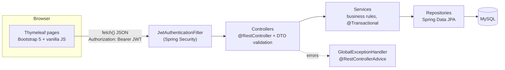
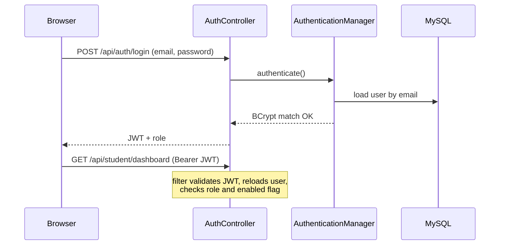
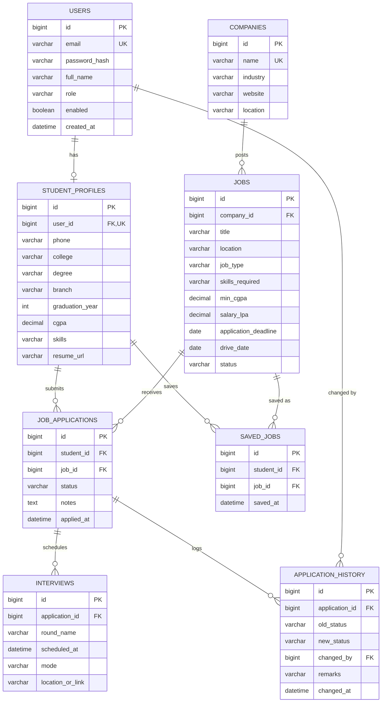

# JobTrack - Smart Job Application & Placement Management System


JobTrack is a full-stack placement platform. **Students** discover jobs, apply, follow each application through the hiring pipeline and see analytics about their progress. **Admins** manage companies, jobs, students and recruitment statuses.

It is built with a Java-only stack on purpose: Spring Boot REST API, Spring Security with JWT, Spring Data JPA on MySQL, Thymeleaf page shells and a vanilla JavaScript front end (no React, Angular or TypeScript).

## Screenshots

| Dashboard | Jobs |
|---|---|
|  |  |

| Application tracker | Admin overview |
|---|---|
|  |  |

## Features

**Students**
- Register and log in (BCrypt password hashing, JWT authentication) and manage a profile with CGPA and skills
- Dashboard: totals per status, status doughnut chart, monthly trend chart, upcoming interviews
- Search jobs by company, role, location and skills; filter by job type and **eligibility** (CGPA); sort and paginate
- Save jobs to a wishlist
- Apply once per job with business rules: job open, deadline not passed, CGPA requirement met
- Application tracker: progress stepper, personal notes, full status history

**Admins**
- CRUD for companies and jobs (jobs with applications must be closed, not deleted)
- Move applications through the pipeline with an enforced state machine and schedule interviews
- Manage student accounts (enable, disable, delete); a disabled student is locked out immediately
- Analytics: success rate, selection vs rejection, company-wise and monthly application statistics

## Technology stack

| Layer | Technology |
|---|---|
| Language / build | Java 21, Maven |
| Backend | Spring Boot 3.3, Spring MVC, Spring Data JPA (Hibernate), Bean Validation |
| Security | Spring Security, JWT (JJWT), BCrypt, role-based access (STUDENT, ADMIN) |
| Database | MySQL 8 (H2 in tests) |
| Frontend | Thymeleaf, HTML5, CSS3, Bootstrap 5, vanilla JavaScript, Chart.js |
| Testing | JUnit 5, Mockito, AssertJ, MockMvc, Postman / Newman, JaCoCo |
| Tooling | IntelliJ IDEA, Postman, Git, GitHub Actions |

## Architecture



Request flow: the filter validates the JWT and loads the user, the controller validates the request DTO, the service applies business rules inside a transaction, the repository talks to MySQL, and the service maps entities to response DTOs. Entities never leave the service layer, which avoids lazy-loading errors and accidental data leaks.



### Package structure
```
com.jobtrack
├── config/        SecurityConfig, AdminInitializer
├── controller/
│   ├── api/       REST controllers (student, admin, auth)
│   └── web/       Thymeleaf page routes
├── dto/           request/ and response/ records
├── entity/        JPA entities and enums
├── exception/     custom exceptions, GlobalExceptionHandler, ApiError
├── mapper/        entity to DTO conversion
├── repository/    Spring Data repositories, Specifications, projections
├── security/      JwtUtil, JwtAuthenticationFilter, UserPrincipal, CurrentUser
└── service/       business logic
```

## Database design



Key decisions: `(student_id, job_id)` is unique on applications and saved jobs (the database is the last line of defence against double-submits), `SavedJob` is an explicit entity so it can carry `saved_at`, status values are stored as strings so reordering an enum never corrupts data, and every status change writes an `application_history` row in the same transaction.

Application status flow: `APPLIED -> UNDER_REVIEW -> ONLINE_ASSESSMENT -> INTERVIEW -> SELECTED`, with `REJECTED` allowed from any non-final stage. Illegal jumps are rejected with HTTP 422.

## API documentation

All endpoints are under `/api`. Authenticate with `Authorization: Bearer <token>` from `POST /api/auth/login`. Lists accept `?page=0&size=10&sort=field,asc|desc` (max size 50). Errors share one JSON shape: `{timestamp, status, error, message, path, fieldErrors?}`.

| Area | Endpoints |
|---|---|
| Auth (public) | `POST /api/auth/register`, `POST /api/auth/login` |
| Student profile | `GET/PUT /api/student/profile`, `GET /api/student/dashboard` |
| Wishlist | `GET /api/student/saved-jobs`, `POST/DELETE /api/student/saved-jobs/{jobId}` |
| Jobs | `GET /api/jobs` (company, role, location, skills, jobType, eligibleOnly), `GET /api/jobs/{id}` |
| Applications | `POST /api/applications`, `GET /api/applications`, `GET /api/applications/{id}`, `PATCH .../notes`, `GET .../history` |
| Admin | `/api/admin/companies`, `/api/admin/jobs`, `/api/admin/applications`, `/api/admin/students`, `GET /api/admin/analytics` |

Status codes: 200, 201, 204, 400 validation, 401 unauthenticated, 403 forbidden, 404, 409 duplicate, 422 business rule violated.

Full endpoint table: [docs/API.md](docs/API.md). Ready-to-use Postman collections are in [`postman/`](postman).

## Getting started

### Prerequisites
Java 21, Maven 3.9+, MySQL 8 (or Docker), and optionally Postman.

### 1. Database
Either install MySQL and run:
```bash
mysql -u root -p < src/main/resources/db/schema.sql
mysql -u root -p < src/main/resources/db/seed.sql     # optional sample companies and jobs
```
or use Docker (set `DB_PASSWORD` in a local `.env` file first; schema and sample data load automatically):
```bash
docker compose up -d
```

### 2. Configuration
No secrets are stored in the repository. Set these environment variables (in IntelliJ: Run Configuration -> Environment variables). See `.env.example`.

| Variable | Purpose |
|---|---|
| `DB_PASSWORD` | MySQL password (required) |
| `DB_URL`, `DB_USERNAME` | Optional, default to localhost and `root` |
| `JWT_SECRET` | Required. Base64, 32+ bytes. Generate with `openssl rand -base64 48` |
| `JWT_EXPIRATION_MS` | Optional, default 24 hours |
| `ADMIN_EMAIL`, `ADMIN_PASSWORD` | First admin account, created on startup (password 8+ characters) |

### 3. Run
```bash
mvn spring-boot:run
```
Open http://localhost:8080 and register a student, or log in with the admin credentials you configured.

### 4. Test
```bash
mvn test        # about 89 tests, no database needed (uses H2)
```
Coverage report: `target/site/jacoco/index.html`. See [docs/TESTING.md](docs/TESTING.md) for the Postman regression suite and the manual checklist.

### Troubleshooting

| Symptom | Fix |
|---|---|
| `Could not resolve placeholder 'DB_PASSWORD'` | Set the environment variable (an empty value is allowed) |
| `Access denied for user` | Check `DB_USERNAME` and `DB_PASSWORD` |
| `Schema-validation: missing table/column` | Re-run `schema.sql` on a clean `jobtrack` database |
| `JWT_SECRET must be a Base64 string` | Generate it with `openssl rand -base64 48` |
| Redirected to login again and again | Token expired or account disabled; log in again |

## Security notes
- Passwords are hashed with BCrypt and never returned by the API.
- Stateless JWT authentication with role-based URL rules. The user is reloaded from the database on every request, so disabling an account takes effect immediately.
- All input is validated (Bean Validation) and all dynamic text is HTML-escaped in the UI.
- Secrets come from environment variables only. `.env` is git-ignored.
- A student asking for another student's application receives 404, not 403, so existence is not revealed.
- Trade-off: the JWT is kept in `localStorage`, which is simple but readable by injected scripts. A production system would prefer an HttpOnly cookie with CSRF protection, plus refresh tokens and login rate limiting.

## Future enhancements
- Refresh tokens, HttpOnly cookie auth, login rate limiting and account lockout
- Email notifications (interview reminders, status changes) and calendar export
- Resume upload with file storage instead of a link
- Normalized skills table with skill-based job recommendations
- Flyway migrations instead of a manual schema script
- OpenAPI/Swagger documentation
- Dockerfile for the application and a full docker-compose stack
- Server-side sorting whitelist and Redis caching for analytics
- Testcontainers so integration tests run against real MySQL

## License
MIT. See [LICENSE](LICENSE).
